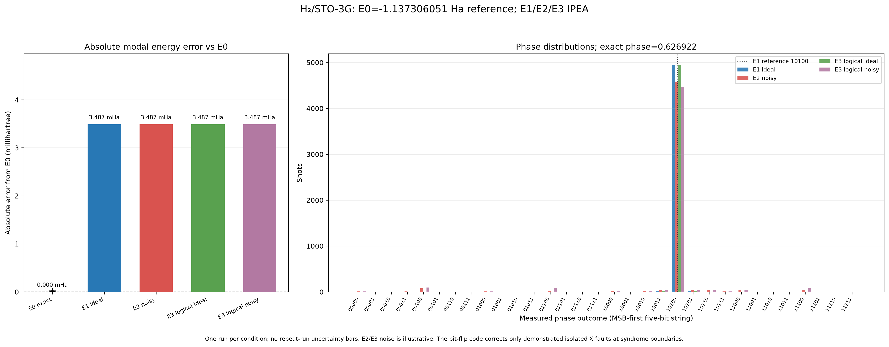
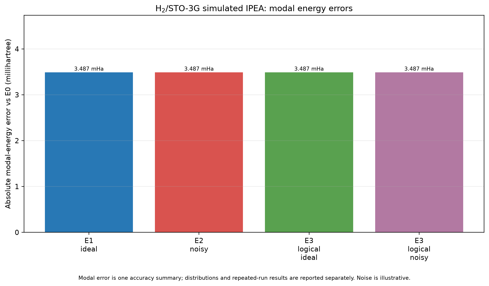
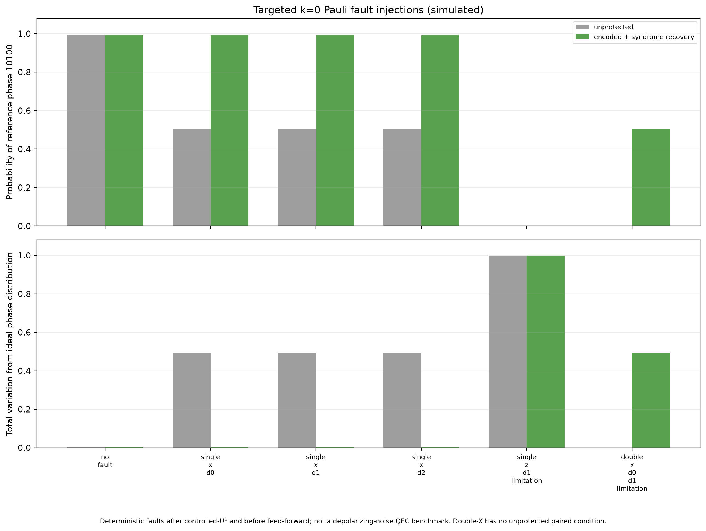

# Error-Corrected Quantum Chemistry: Team Catalyst

**Quantinuum Singapore Grand Challenge | Themes: QEC, Chemistry | Track: Aqora**

## Summary

We investigate whether quantum error correction (QEC) can improve the reliability of Iterative Quantum Phase Estimation (IPEA) for molecular energy calculations. The target is the ground-state energy of H₂ (STO-3G basis, reduced two-qubit Hamiltonian). We compare quantum estimates against a classical reference of about −1.137306 Hartree and evaluate a three-qubit bit-flip repetition code inside a logical IPEA workflow.

## Team

Team Catalyst: CS1, CS2, DevOps Engineer.

## Experiments

| ID | Description |
|----|-------------|
| E0 | Classical reference: exact diagonalization of the reduced Hamiltonian |
| E1 | Ideal IPEA (noiseless simulation) |
| E2 | Noisy IPEA (fixed illustrative noise on gates, state preparation and measurement) |
| E3 | QEC-enabled IPEA with a three-qubit repetition code, under ideal and noisy conditions |

The design separates the effect of noise from the behaviour of the error-correction implementation, rather than assuming QEC necessarily improves the result.

## Problem setup

- Molecule: H₂, bond length 0.73486 Å, STO-3G, charge 0, multiplicity 1
- Reduced to 2 qubits after tapering
- 5-bit IPEA, phase convention U(t) = exp(−iHt), energy search interval [−1.2, −1.0] Ha
- E0 = −1.1373060511988444 Ha (`numpy.linalg.eigh` on the 4×4 qubit Hamiltonian); ground-state preparation fidelity 1.0

## Repository structure

| Path | Purpose |
|------|---------|
| `hamiltonian.py`, `reference.py` | Hamiltonian construction and classical reference (E0) |
| `state_prep.py`, `time_evolution.py` | Ground-state preparation and controlled time evolution |
| `ipea.py` | IPEA library (E1, E2) |
| `noise_model.py` | Illustrative depolarizing noise model |
| `repetition_code.py`, `qec_repetition_demo.py`, `qec_logical_ops.py` | Repetition code and logical-operation components |
| `qec_logical_ipea.py` | Logical IPEA (E3) and the E0–E3 comparison |
| `targeted_fault_injection.py` | Targeted X-fault experiments |
| `repeat_noise_comparison.py` | Repeated independent-seed E2/E3 noise runs |
| `analyze_e0_e1_e2_e3.py` | Statistical analysis of saved records |
| `plot_*.py` | Figures |
| `test_*.py` | Unit tests (120 tests) |
| `results/` | Saved JSON data and PNG/SVG figures |

## Setup

Requires Python 3.11 (developed on 3.11.9).

```
python -m venv venv
venv\Scripts\activate
pip install -r requirements.txt
```

Main dependencies: guppylang, selene-sim, pytket, numpy, matplotlib, pytest.

## Run the tests

```
pytest
```

All 120 tests pass (about 2 minutes). A deprecation warning from guppylang's tket extension is expected and harmless.

## Reproduce the results

Run from the repository root. Scripts write to `results/` and may overwrite saved files.

```
python reference.py                      # E0 reference -> results/e0.json
python state_prep.py                     # ground-state preparation check
python time_evolution.py                 # controlled time-evolution check
python qec_logical_ipea.py               # E3 ideal + noisy, writes the E0-E3 comparison
python targeted_fault_injection.py       # targeted X-fault experiment
python repeat_noise_comparison.py        # repeated E2/E3 noise runs
python analyze_e0_e1_e2_e3.py            # statistical analysis
python plot_comparison.py                # E0/E1/E2 and E3 component figures
python plot_e0_e1_e2_e3_comparison.py    # four-way comparison figure
python plot_statistical_analysis.py      # statistical and fault figures
```

Scripts with options (for example `repeat_noise_comparison.py`: `--shots-per-run`, `--repeats`, `--seeds`) document them under `--help`.

**Optional: regenerating the Hamiltonian.** `hamiltonian.py` additionally requires `openfermion` and `openfermionpyscf`, which are not in `requirements.txt`. Its output, `results/hamiltonian.json`, is already saved, so this step is not needed to reproduce the rest.

**Saved data.** The E1/E2 record `results/ipea_e1_e2_comparison.json`, together with `results/e3_repetition_component.json` and `results/e2_e3_spread_seed_repeats.json`, is provided as saved data. The downstream scripts and tests read these files.

## Results

All results are in `results/`. The main four-way comparison is `results/e0_e1_e2_e3_comparison.json`, and the statistical analysis is in `results/e0_e1_e2_e3_statistical_analysis.json`. Repeated-seed noise runs are in `results/e2_e3_repeated_noise_runs.json`, and the targeted-fault experiment is in `results/e3_targeted_x_fault_experiment.json`.







## Limitations

- Results come from local Guppy/Selene emulator runs, not a demonstrated run on Quantinuum H2 hardware.
- Noise parameters are illustrative, not calibrated to a specific hardware run.
- The three-qubit repetition code corrects only a limited class of bit-flip errors and does not provide general fault tolerance. The logical IPEA is a component-level implementation, not a fault-tolerant one.
- The single-injected-X repetition test (`e3_repetition_component.json`) is a component check, not an energy result.
- The IPEA uses 5 phase bits over the energy interval [−1.2, −1.0] Ha, which limits the energy resolution.
- The Hamiltonian coefficients are our own derivation (`results/hamiltonian.json`); a literature reference (arXiv:2306.16608) is recorded for comparison. The saved FCI reference was compared with the current matrix but not regenerated in this environment, because PySCF and OpenFermion are not in the project venv.
- The main comparison uses one run per condition; repeated-seed runs are reported separately.
- The study covers a single molecule (H₂) at a single bond length. The results evaluate the implemented workflow; they are not proof that QEC improves molecular energy accuracy on current hardware.

## License

MIT License (see `LICENSE`).